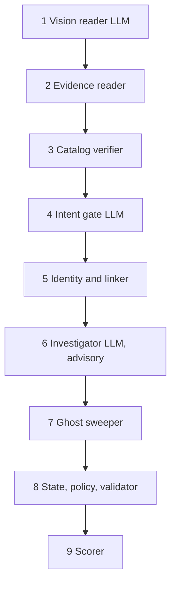

# Agent architecture

The pipeline is a chain of specialised agents; the core is deterministic. Three may call a model (LLM), always with guardrails.

| Agent | Does | LLM role and guardrail |
|---|---|---|
| Vision reader | reads screenshots, sets a state, cross-checks links | cached by image hash; ids validated; never creates links |
| Evidence reader | 7 log dialects, JSON, SQLite incl. replicas, handover text, PDFs, catalog events | none |
| Catalog verifier | contradicted link dropped, unknown identity kept and flagged | none |
| Intent gate | deletion vs access / export / correction / marketing / support | batched, schema-validated; strong rule verdicts win; may rescue a cue-less paraphrase only at 0.85 or more confidence |
| Identity and linker | historical identifiers, identity links, workflow-run reconstruction, lineage | none |
| Investigator | tool loop (get_case_dossier, list_candidates, resource_timeline, search_evidence, policy_for) on ambiguous links | read-only tools, choice must be an engine candidate, advisory unless enabled; agreed with the engine on every case it saw |
| Ghost sweeper | unexplained resources, un-redacted records | none |
| State, policy, validator | plan compilation and contract check | none |
| Scorer | status, step P/R/F1, field, position, Kendall tau, LCS | none |

**Principles:** claims are not proof; rules are the guardrail; investigator is read-only; policy is data; everything is traceable (`trace.jsonl`: user, link reason, deciding evidence, rule, flags).

**Provider router:** priority and key rotation, per-error handling, run budget, disk cache, schema-validated answers with one re-ask, run-scoped usage ledger. Anthropic calls use `output_config.effort="low"` and treat `refusal` as no answer. A `custom` provider supports any OpenAI-compatible endpoint.
