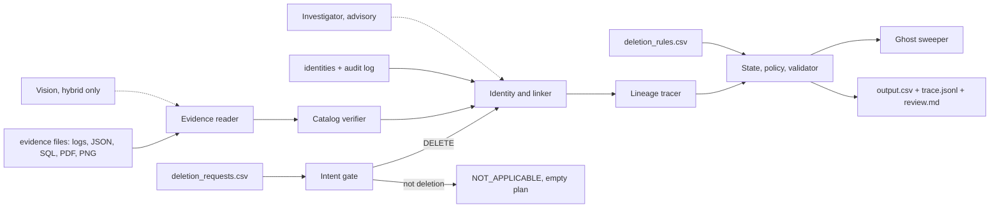
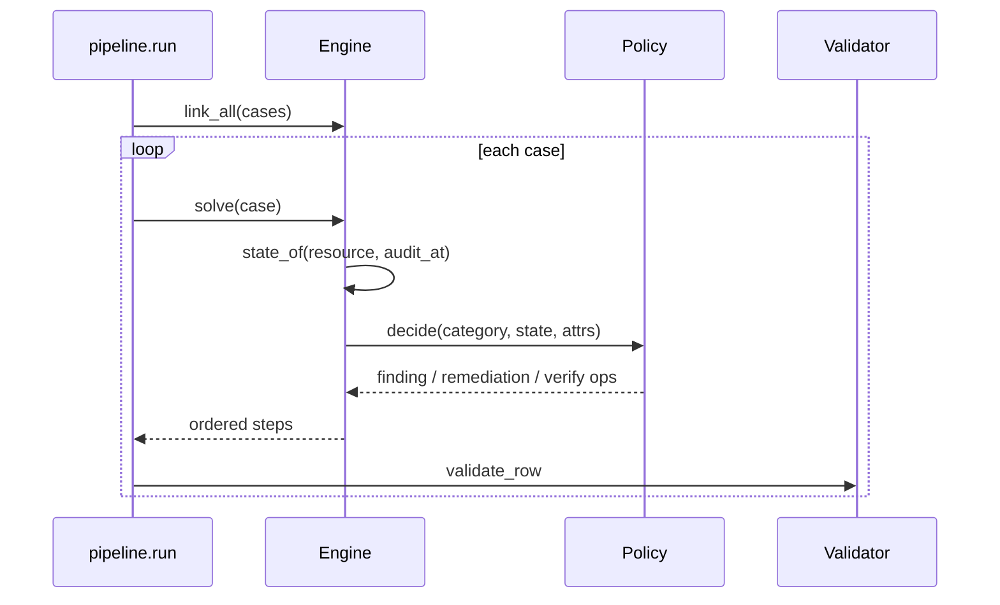

# System architecture

Ghost Data Auditor audits whether a person's data was *actually* deleted at `audit_at`, treating workflow statuses and activity results as **claims**, not proof. A deterministic core reconstructs state from evidence; an LLM layer reads text and pixels behind guardrails.

## Per-case flow
1. **Intent** - multilingual rights lexicon, negation/scope limits, instruction stripping; optional batched LLM classification, rules are the guardrail.
2. **Identity** - request email resolved through current and historical emails, hashes, phones.
3. **Evidence to observations** - every file becomes (file, captured_at, record_time, resource, state, identifiers).
4. **Linking** - identity links first; then deletion-worker activity (time window, result matches claimed status, elimination, workflow-run reconstruction); lineage adds copies recreated by connector/restore jobs at or before `audit_at`.
5. **State at `audit_at`** - type discovery from any record stamped before `audit_at`; state and citation only from files captured by `audit_at`.
6. **Policy** - category, rule (`deletion_rules.csv`), condition (retention date, sharing), action, then finding / remediation / verification operations.
7. **Validation and sweep** - contract validator; ghost sweep greps all evidence for the subject's identifiers.

## Modules (`code/auditor/`)
| Module | Role |
|---|---|
| `intent.py` | request classification |
| `evidence.py` | parsers to observations |
| `corroborate.py` | catalog link vs artifact identifiers |
| `engine.py` | identity, linking, state, plan |
| `lineage.py` | recreation edges (connector, restore) |
| `policy.py`, `taxonomy.py` | declarative policy |
| `validate.py` | contract checks |
| `ghost.py` | grep sweep and redaction leak check |
| `llm/router.py`, `llm/investigator.py` | provider router, advisory agent |
| `events.py` | live run events (UI); no-op in the CLI |
| `pipeline.py` | orchestration, trace, review report |

The same Python runs as the CLI (`python code/main.py`) and in the browser (`docs/index.html`, via Pyodide).
