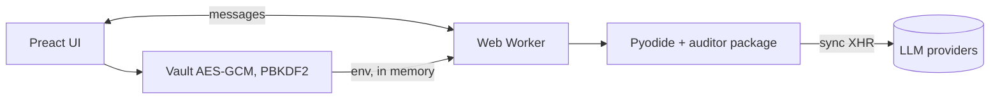

# Web UI (`docs/index.html`)

One self-contained HTML file that runs the **real** Python engine in the browser (Pyodide in a Web Worker). No server, no telemetry.



## Views
Run (dataset, mode, switches, live stages and log), Inputs (requests, evidence parse stats, policy rules, activity), Agents (live pipeline), Results (case table; plan, resources and rules, request and intent, gold diff, JSON; exports), Evaluation (metrics, confusion matrix, demo suite, ablation, link recovery), Monitor (stage timeline, model-call ledger, tokens, cost, flags, event log), Vault, Guide.

## Executions
Offline, Hybrid (LLM), vision on/off, investigator advisory/apply, case limit, ignore LLM cache, demo suite, ablation, link recovery, any uploaded folder / zip / URL dataset. Stop restarts the worker.

## Vault
Keys are encrypted with AES-256-GCM (PBKDF2-SHA256, 310k iterations) in localStorage, or kept session-only in memory. Decrypted keys live in memory while unlocked and go only to the engine worker and the provider. Auto-lock, encrypted export/import, wipe. Providers: Anthropic, OpenAI, Gemini, Groq, custom OpenAI-compatible. Keys never appear in logs, exports or results (tested).

## Themes and responsive
Bases: Obsidian, AMOLED, Graphite, Paper (light); 7 accents; density; mobile bottom nav and sticky Run bar.

## Build, test, deploy
```bash
python webui/build.py                 # writes docs/index.html (inlines Python sources, demo data, icons, Preact)
python webui/tests/test_ui.py --full  # Playwright + Chrome end-to-end, includes CLI parity
```
GitHub Pages: Settings, Pages, deploy from branch `main` folder `/docs`. The page loads the Python runtime from jsDelivr and pypdf from PyPI. Load the full dataset by uploading the `dataset/` folder or zip (it is not embedded). Eight synthetic demo scenarios are built in.
